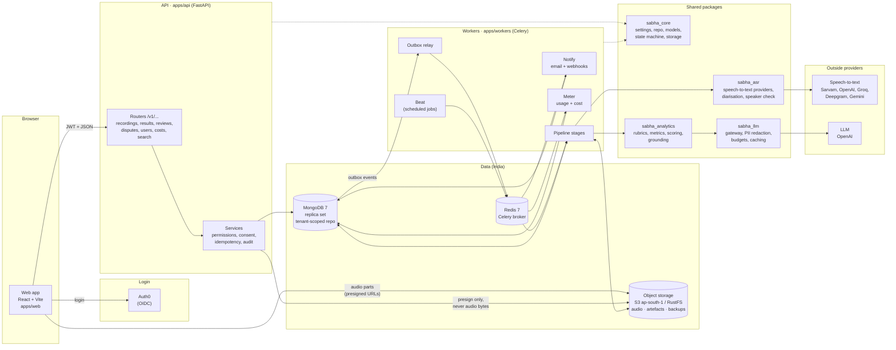
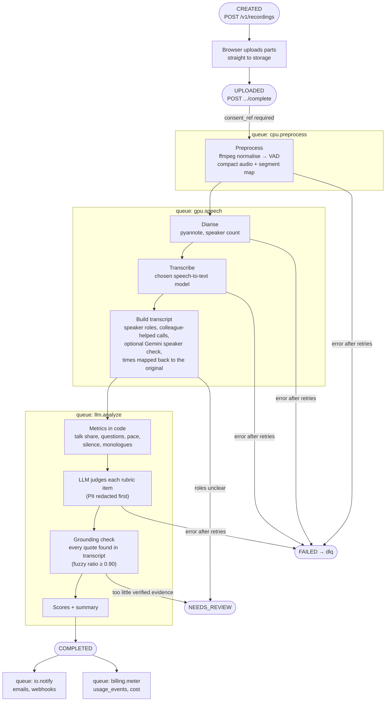

# Sabha architecture

How a recording travels from the browser to a scored, evidence-backed report. Rules behind each box are in
[CLAUDE.md](CLAUDE.md); decisions are in [docs/adr/](docs/adr/).

## System overview

## Recording pipeline

Each stage is idempotent: it first looks for its output at `{tenant_id}/{recording_id}/{stage}@{version}/` and exits
if it is there. Status moves only through `sabha_core/state.py`.

## Scheduled jobs (Celery beat)

| Job | Every | Does |
| --- | --- | --- |
| `abort_stale_uploads` | hour | cancels uploads never completed |
| `requeue_stuck` | 5 min | re-sends stages whose worker died |
| `expire_audio` | day | deletes audio past its retention |
| `backup` | day | exports the database to the backups bucket |
